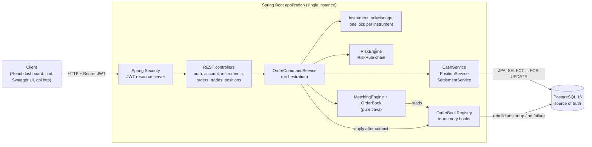
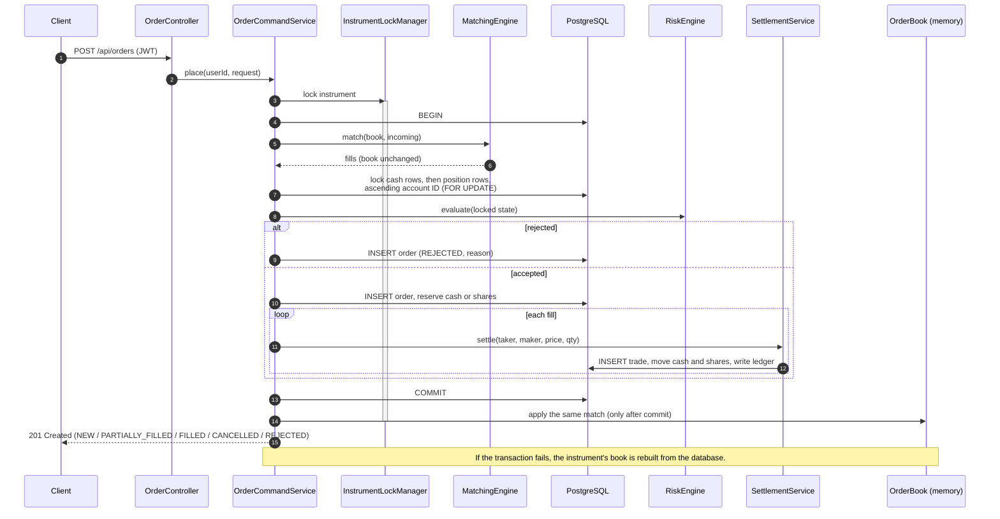

# Trading & Risk Platform

[](https://github.com/a0930928334-jpg/trading-risk-platform/actions/workflows/ci.yml)

A simulated equities trading back end built with Java 21 and Spring Boot 3. Users register, deposit
(simulated) cash and trade five instruments with limit orders. Every order passes a chain of pre-trade risk
checks, reserves the cash or shares it needs, and is matched by an in-memory price-time priority engine.
PostgreSQL is the source of truth for every order, trade, cash movement and position.
A React dashboard shows the live order book and lets you trade from the browser.

This is a portfolio project, not a real exchange: instruments, prices and liquidity are simulated.

## Contents

- [What it does](#what-it-does)
- [Architecture](#architecture)
- [Order placement flow](#order-placement-flow)
- [Design decisions](#design-decisions)
- [Tech stack](#tech-stack)
- [Quick start](#quick-start)
- [Demo](#demo)
- [API](#api)
- [Testing](#testing)
- [Configuration](#configuration)
- [Project layout](#project-layout)
- [Limitations and roadmap](#limitations-and-roadmap)

## What it does

| Area | Implemented in v0.1 |
|---|---|
| Authentication | Registration (BCrypt), login returning an HS256 JWT (1 hour, subject = user ID), every other endpoint protected except health and API docs |
| Cash | USD balance with `reserved` and `available = balance - reserved`; deposits; an append-only ledger of every movement (`DEPOSIT`, `RESERVE`, `RELEASE`, `TRADE_DEBIT`, `TRADE_CREDIT`) |
| Instruments | AAPL, MSFT, NVDA, TSLA, AMZN seeded by Flyway with **simulated** reference prices |
| Positions | Shares per instrument with `reserved_quantity`; short selling is impossible (risk rule and database constraint) |
| Orders | Limit orders, good till cancelled; place, list, get and cancel; risk-rejected orders are stored as `REJECTED` with a reason |
| Pre-trade risk | Pluggable rule chain: account status, instrument status, maximum order value (default 100,000), price band (default ±10% from the last trade or reference price), available cash, available shares |
| Matching | One in-memory order book per instrument, price-time priority, partial fills, trades at the resting order's price, self-trade prevention (cancel newest), order book depth endpoint |
| Settlement | Buyer pays from reserved cash and gets any price improvement released; seller delivers reserved shares; last trade price updated |
| Recovery | Order books rebuilt from open orders at startup and after any failed transaction |
| Liquidity (dev only) | A system market maker account with cash and shares quotes five non-crossing levels per side on every instrument |
| Errors | RFC 9457 problem details everywhere, including 401/403 |
| Web dashboard | React + TypeScript single-page app: log in or register, deposit, instrument list, live order book (click a level to use its price), order entry with value and price-band hints, open orders with cancel, order history, trades, positions and cash ledger; refreshes by polling every 1.5–5 seconds |
| Delivery | Flyway migrations, OpenAPI/Swagger UI, Testcontainers tests, GitHub Actions CI |

## Architecture



Redis and Kafka containers are defined in `docker-compose.yml` but are **reserved for v0.2**; the application
does not use them.

## Order placement flow



## Design decisions

Each decision has an Architecture Decision Record with the context, options and consequences:

| ADR | Decision |
|---|---|
| [0001](docs/adr/0001-jwt-authentication-with-resource-server.md) | JWT (HS256) with Spring Security's OAuth2 resource server; no refresh token in v0.1 |
| [0002](docs/adr/0002-cash-reservation-and-ledger.md) | Reserve cash and shares at placement; append-only cash ledger |
| [0003](docs/adr/0003-database-as-source-of-truth-with-in-memory-order-books.md) | PostgreSQL is the source of truth; in-memory order books are a cache updated after commit and rebuilt on failure |
| [0004](docs/adr/0004-locking-strategy.md) | One lock per instrument; pessimistic row locks in ascending account ID order to prevent deadlocks |
| [0005](docs/adr/0005-limit-orders-only.md) | Limit orders only: the limit price bounds the reservation |
| [0006](docs/adr/0006-pluggable-pre-trade-risk-rule-chain.md) | Pre-trade risk as a chain of independently tested `RiskRule` beans |
| [0007](docs/adr/0007-problem-details-for-errors.md) | RFC 9457 problem details for every error |

## Tech stack

Java 21 · Spring Boot 3.5 (Web, Data JPA, Security, OAuth2 Resource Server, Validation, Actuator) ·
PostgreSQL 16 · Flyway · Lombok · springdoc-openapi · JUnit 5, AssertJ, MockMvc, Testcontainers ·
Maven wrapper · Docker Compose · GitHub Actions ·
Front end: React 18, TypeScript, Vite, Vitest

## Quick start

Prerequisites: Java 21, Docker (Docker Desktop on Windows/macOS). Maven is provided by the wrapper.

```bash
# 1. Start PostgreSQL (Redis and Kafka in the compose file are not needed for v0.1)
docker compose up -d postgres

# 2. Run with the dev profile: provides a development JWT secret and starts the simulated market maker
./mvnw spring-boot:run -Dspring-boot.run.profiles=dev
```

Then, in a second terminal, start the dashboard (Node.js 24 with npm 11):

```bash
cd frontend
npm install
npm run dev
```

- Dashboard: <http://localhost:5173> (create an account, deposit, then trade against the market maker)
- API: <http://localhost:8080>
- Swagger UI: <http://localhost:8080/swagger-ui/index.html> (log in, then use **Authorize** with the access token)
- Health: <http://localhost:8080/actuator/health>

Outside the `dev` profile the application needs `JWT_SECRET` (at least 32 bytes) and does not start the market maker.
Flyway creates the schema on startup.

## Demo

With the application running in the `dev` profile:

```bash
scripts/demo.sh
```

The script (bash, curl and sed only; runs in Git Bash on Windows) registers a new user, logs in, deposits
50,000 USD, shows the AAPL order book, buys 150 AAPL at up to 192.00 against the market maker's asks, prints
the trades, positions and balance, places and cancels a resting order, shows a price-band rejection, and
prints the cash ledger.

The market maker quotes 500 shares per side per instrument when it first starts, and does not top up
on later restarts, so repeated runs consume its asks: later runs may show `PARTIALLY_FILLED`.

[`api.http`](api.http) contains the same flow for the IntelliJ HTTP Client or the VS Code REST Client.

## API

All endpoints except register, login, health and the OpenAPI docs require `Authorization: Bearer <token>`.
List endpoints take `page` (from 0) and `size` (default 20, maximum 100) and return
`{content, page, size, totalElements, totalPages}`.

| Method | Path | Description |
|---|---|---|
| POST | `/api/auth/register` | Create a user, account and zero cash balance |
| POST | `/api/auth/login` | Returns `accessToken`, `tokenType`, `expiresIn`, `expiresAt` |
| GET | `/api/me` | Current user and account identifiers |
| GET | `/api/account` | `balance`, `reserved`, `available` |
| POST | `/api/account/deposits` | Deposit simulated USD (up to 1,000,000 per request) |
| GET | `/api/account/ledger` | Cash ledger, newest first |
| GET | `/api/instruments` | Instruments with reference and last trade prices |
| GET | `/api/instruments/{symbol}/book?depth=10` | Aggregated bids and asks, best first |
| POST | `/api/orders` | Place a limit order: `{symbol, side, price, quantity}` |
| GET | `/api/orders?status=` | My orders, newest first |
| GET | `/api/orders/{id}` | One of my orders |
| DELETE | `/api/orders/{id}` | Cancel an open order and release its reservation |
| GET | `/api/trades` | My trades with side, order and MAKER/TAKER liquidity |
| GET | `/api/positions` | My positions with reserved and available quantity |

`POST /api/orders` returns **201 for every well-formed order**; check `status`. An order that fails a risk
check is stored with `status: REJECTED`, a `rejectCode` (for example `INSUFFICIENT_FUNDS`, `PRICE_OUT_OF_BAND`)
and a `rejectReason`. A malformed request (400) or an unknown symbol (404) is not stored.

Errors are problem details:

```json
{
  "type": "urn:problem-type:order-not-cancellable",
  "title": "Conflict",
  "status": 409,
  "detail": "Order 42 cannot be cancelled in status FILLED",
  "instance": "/api/orders/42",
  "code": "order-not-cancellable"
}
```

## Testing

```bash
./mvnw verify
```

Docker must be running: integration tests start a PostgreSQL 16 container with
[Testcontainers](https://testcontainers.com/), shared by all test classes. They need no local database,
and CI runs the same command.

The suite has **172 test cases** (156 test methods; parameterised tests count once per case):

| Kind | Cases | What they cover |
|---|---|---|
| Unit (no Spring, no database) | 75 | Matching engine and order book (including a seeded 5,000-order random flow that checks the book never stays crossed and every share is accounted for), each risk rule, order state transitions, cash and position domain rules, JWT issuing |
| Integration (Spring context + PostgreSQL) | 93 | Every endpoint through MockMvc, authentication failures, reservations and releases, settlement of both sides, self-trade prevention, rollback and order book rebuild after a forced failure, database constraints, OpenAPI document |
| Concurrency | 4 | 12 threads trading two instruments over shared accounts, 16 threads depositing into one account, and the instrument lock (serial per instrument, parallel across instruments) |

The concurrent trading test checks afterwards that total cash and total shares are unchanged, no balance,
reservation or position is negative, every reservation equals what the open orders hold, each account's
ledger replays to its balance, and each in-memory book equals a fresh rebuild from the database.

The front end has its own Vitest unit tests for its formatting and calculation helpers
(`cd frontend && npm test`); CI type-checks and builds it in a separate job.

Tests that trade create their own randomly named instrument, so they never share an order book and need
no clean-up. No test depends on the market maker.

## Configuration

| Property | Default | Meaning |
|---|---|---|
| `JWT_SECRET` (`app.security.jwt.secret`) | none (dev profile has a default) | HS256 key, at least 32 bytes |
| `app.security.jwt.ttl` | `PT1H` | Token lifetime |
| `app.risk.max-order-notional` | `100000` | Maximum `quantity x price` per order |
| `app.risk.price-band-percent` | `10` | Maximum distance of the limit price from the last trade (or reference) price |
| `app.market-maker.*` | see `MarketMakerProperties` | Dev market maker cash, shares, levels, step and size |
| `spring.datasource.*` | local docker-compose PostgreSQL | Database connection |

## Project layout

```
src/main/java/com/shuhongyi/trading
├── auth          registration, login, JWT issuing, @CurrentUserId
├── user          /api/me
├── account       accounts, cash balances, cash ledger, deposits
├── instrument    instruments and reference prices
├── position      positions and share reservations
├── risk          RiskEngine, RiskRule and the rules
├── matching      pure Java order book and matching engine
├── order         order commands and queries, instrument locks, order book registry
├── trade         trades and settlement
├── marketmaker   dev-only simulated liquidity
├── common        problem details, money and pagination helpers
└── config        security, OpenAPI, web and clock configuration
src/main/resources/db/migration   Flyway V1–V6
docs/adr                          architecture decision records
frontend/                         React + Vite dashboard (proxies /api to :8080 in development)
scripts/demo.sh, api.http         demo flows
```

## Limitations and roadmap

Not implemented in v0.1:

- **Market orders** and other time-in-force types (IOC, FOK, day): a market order has no price to reserve against ([ADR 0005](docs/adr/0005-limit-orders-only.md)).
- **Refresh tokens and token revocation**: access tokens are valid until they expire ([ADR 0001](docs/adr/0001-jwt-authentication-with-resource-server.md)).
- **Kafka events** for orders and trades: the Kafka container is reserved for v0.2.
- **Redis caching** (for example order book snapshots or market data): the Redis container is reserved for v0.2.
- **Python anomaly detection** on order and trade flow.
- **Horizontal scaling**: order books and instrument locks live in one JVM, so v0.1 runs as a single instance ([ADR 0003](docs/adr/0003-database-as-source-of-truth-with-in-memory-order-books.md)).
- Withdrawals, multiple currencies, multiple accounts per user, fees, average cost and P&L, real market data.
- Idempotency keys for order placement and deposits.
- Stateful risk rules such as order rate limits or daily loss limits.
- No performance benchmarks have been run, so none are reported.
